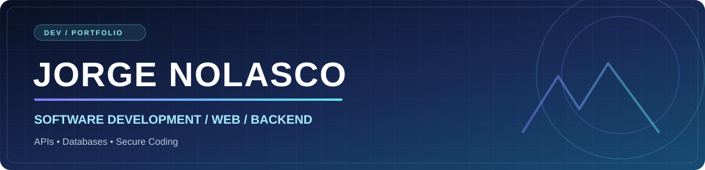

<!-- README do perfil github.com/JorgeNoolasco -->
<div align="center">



### Python · PHP · JavaScript · SQL

**Desenvolvimento Web · Backend · APIs REST · Banco de Dados**

[LinkedIn](https://www.linkedin.com/in/jorge-nolasco-bb2806359/) ·  [Meus repositórios](https://github.com/JorgeNoolasco?tab=repositories)

</div>

## 👨‍💻 Sobre mim

```yaml
name: Jorge Nolasco
education: Técnico em Desenvolvimento de Sistemas | SENAI CTTI
location: Belo Horizonte, Brasil
focus:
  - Web Development
  - Backend and REST APIs
  - SQL and Databases
  - Secure Software Development
currently_learning:
  - Software Architecture
  - Cybersecurity Fundamentals
  - API Security
```

Sou estudante de **Desenvolvimento de Sistemas** e desenvolvo aplicações web, APIs e soluções com bancos de dados. Busco combinar organização de código, experiências úteis e boas práticas de segurança.


---

## 🧰 Tecnologias e ferramentas

<div align="center">

**Linguagens & Frontend**


**Backend & Bancos de Dados**


**Ferramentas & Plataformas**


</div>

> Se o serviço de ícones ficar indisponível, as tecnologias continuam descritas nos textos alternativos acima.

---

## 🚀 Projetos em destaque

| Projeto | Descrição | Tecnologias |
|---|---|---|
| [🛒 Dessik](https://github.com/JorgeNoolasco/Dessik) | E-commerce com frontend, carrinho e integração com [API backend](https://github.com/JorgeNoolasco/Dessik-BackEnd). | JavaScript, FastAPI, PostgreSQL |
| [💧 Control Hydro](https://github.com/JorgeNoolasco/Control_Hydro) | Sistema web em PHP com autenticação e integração a banco de dados. | PHP, SQL, HTML, CSS |
| [📘 BlueMath](https://github.com/JorgeNoolasco/BlueMath) | Plataforma educacional com quiz e experimentos de integração com IA. [Backend](https://github.com/JorgeNoolasco/BlueMath-Backend). | HTML, CSS, JavaScript |
| [⚡ EnergiaMax](https://github.com/JorgeNoolasco/EnergiaMax) | Modelagem de dados para estoque e produção. | MySQL, SQL |

**Outros projetos:** [Estoque PHP](https://github.com/JorgeNoolasco/Estoque_PHP) · [Landing Page](https://github.com/JorgeNoolasco/LandingPage) · [Primeiro PHP](https://github.com/JorgeNoolasco/Primeiro_PHP)

---

## 🎯 Atualmente estudando

```text
Software Development
├── Frontend: HTML, CSS, JavaScript
├── Backend: Python, FastAPI, PHP
├── Databases: PostgreSQL, MySQL, Supabase
├── APIs: REST, Authentication, Integrations
└── Security: Secure Coding and API Security
```

## 📊 GitHub

Confira meus [repositórios e contribuições diretamente no GitHub](https://github.com/JorgeNoolasco). Assim, os dados não dependem de serviços de estatísticas externos que podem sair do ar.

---

<div align="center">

**Keep building. Keep learning.**

Desenvolvido com ☕, código e curiosidade.

</div>
